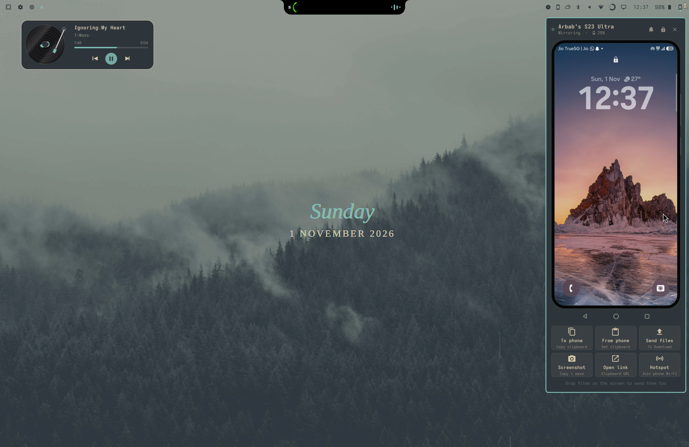

# OmaEcosystem



Your Android phone as part of the Omarchy desktop. Click the phone icon in the
bar and a phone-shaped dock slides in on the right showing the phone's live
screen at a real 5-inch size. You can use it with the mouse and keyboard
directly. One-click tiles underneath do the rest.

## Features

- **Live, controllable screen** (scrcpy over wireless ADB), pinned on every workspace
- **To phone**: copy the laptop clipboard to the phone. Copied files and images are sent as files
- **From phone**: copy the phone's clipboard to the laptop
- **Send files**: pick files and they go to the phone's `Download` folder. Name clashes get ` (1)`. You can also drop files onto the screen
- **Screenshot**: grab the phone screen to the clipboard and `~/Pictures/Phone`
- **Open link**: open the URL in the laptop clipboard on the phone
- **Hotspot**: wake the phone's hotspot over Bluetooth and join it, with no network needed (see [Hotspot](#hotspot))
- **Stays connected**: in the background the plugin reconnects wireless ADB and, when you plug the phone in, switches it to wireless so you can unplug it
- **Header**: battery, a live light, pull down notifications, lock the phone, undock
- **Nav keys**: back, home, recents

## Tests

```sh
python3 -m unittest discover -s tests   # no phone or Hyprland needed
```

## Requirements

`scrcpy`, `android-tools` (adb), `wl-clipboard` and `zenity`. The hotspot also
uses `bluez-utils` (bluetoothctl) and NetworkManager, which Omarchy ships.
Nothing else: the plugin does not need phone-mirror or any config file.

## First-time setup

If no phone is set up yet, the dock shows these steps on the phone screen itself.

1. On the phone: **Settings › About phone › Software information**, tap **Build number** 7 times.
2. **Settings › Developer options**, turn on **USB debugging**.
3. Plug the phone into the laptop with a **USB cable** and tap **Allow** on the
   "Allow USB debugging?" prompt (tick *Always allow*). Then press **Try again**.

**USB is recommended.** It is the fastest link with the least lag, and the
dock always picks USB when the cable is in. Wireless works too: turn on
**Wireless debugging** and run `adb pair` once, or simply plug in once: the
plugin switches the phone to wireless ADB by itself and tells you when you can
unplug. When the cable is unplugged the mirror pauses, and **Reconnect** picks
up the wireless link.

A stock phone forgets wireless ADB when it reboots. After a phone restart,
plug it in once and it switches back over automatically.

## Hotspot

The **Hotspot** tile turns on the phone's hotspot and joins it, even when the
laptop has no network. The laptop opens a small Bluetooth link to the phone
(remote-control profile only, no audio or calls), a routine on the phone turns
the hotspot on, and the laptop joins it as soon as it appears.

One-time setup:

1. Pair the phone with the laptop over Bluetooth.
2. On the phone, make a routine: *When Bluetooth device &lt;this laptop&gt;
   connects → turn on Mobile Hotspot* (Samsung: **Modes and Routines**; other
   phones: Tasker or a similar app).
3. Dock the phone once, so the plugin learns the hotspot's name.
4. Join the hotspot once from the Wi-Fi menu, so the laptop remembers its password.

The phone's Bluetooth address is found by matching its paired name. If that
doesn't work, or the name is different, set it yourself (see Settings).

## Install

```sh
omarchy plugin add https://github.com/arbabmujtaba/omaecosystem.git --enable
```

A phone icon appears on the right of the bar. Click it to dock the phone.

From a local checkout instead: `make enable`.

## Remove

```sh
omarchy plugin remove io.github.arbabmujtaba.omaecosystem
```

Nothing is left running once the plugin is removed: closing the dock stops
scrcpy and removes its Hyprland window rule, and the background keeper stops
with the plugin. The phone keeps a small helper file at
`/data/local/tmp/omaecosystem-server.jar`; remove it with
`adb shell rm /data/local/tmp/omaecosystem-server.jar` if you like.

Toggle from a keybinding:

```sh
omarchy-shell shell toggle io.github.arbabmujtaba.omaecosystem '{}'
```

## Settings

```sh
omarchy bar set io.github.arbabmujtaba.omaecosystem screenInches 5 --json      # 3-9, shrinks to fit
omarchy bar set io.github.arbabmujtaba.omaecosystem reserveSpace true --json   # tile windows beside it
omarchy bar set io.github.arbabmujtaba.omaecosystem phoneScreenOff true --json # phone display dark while docked
omarchy bar set io.github.arbabmujtaba.omaecosystem keepWireless false --json  # no background ADB keeper
omarchy bar set io.github.arbabmujtaba.omaecosystem hotspotBluetooth AA:BB:CC:DD:EE:FF
omarchy bar set io.github.arbabmujtaba.omaecosystem hotspotWifi "My hotspot"   # Wi-Fi connection name or SSID
```

Existing [phone-mirror](../phone-mirror) users: its
`~/.config/phone-mirror/config` is still read if present (`PHONE_SERIAL`,
`PHONE_ADDR`, `PHONE_AUDIO`, `PHONE_SCRCPY_ARGS`, `PHONE_BT_MAC`, `PHONE_WIFI`,
`PHONE_HOTSPOT_WAIT`). If its `phone-adb-keeper` is running, the plugin
leaves wireless ADB to it.

## How it works

The dock is a layer-shell surface with a transparent, click-through hole where
the screen is. `bin/omaecosystem mirror` runs scrcpy borderless and, through a
Hyprland window rule and a watch loop, keeps its window floating, pinned and
exactly under the hole, including after resizes and rotations. Closing the
dock stops scrcpy and removes the rule.

Clipboard actions start a short control-only scrcpy-server session (no video),
so setting the phone clipboard never pastes anything. Logs are in
`$XDG_RUNTIME_DIR/phone-mirror/omaecosystem.log`.
